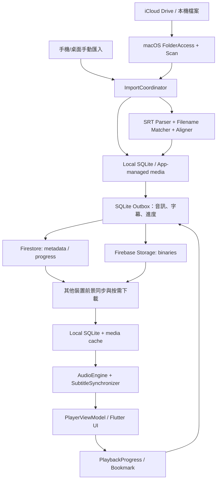

# 系統架構與資料流

## 1. 一眼看懂全貌



**資料方向**：使用者檔案 → 授權來源 → 匯入與識別 → 本機可靠保存 → 冪等雲端發佈 → 異機取用 → 播放與學習 → 進度回寫。不可用「一個 Repository 做全部」代替因果鏈。

## 2. 程式模組和依賴方向
```text
lib/
  main.dart                # Riverpod composition、AudioEngine、帳號切換
  app/                     # 教材庫主畫面與導航入口
  core/
    audio/                 # 播放與系統媒體契約、原生 Adapter、單句 clip
    db/                    # 帳號 scope、DB 選擇、schema 與 migration
    files/                 # App 私有檔案、檔案型態、雜湊與複製
    firebase/              # Firebase 端點與共用 HTTP client
    platform/              # macOS 授權資料夾 MethodChannel gateway
    sync/                  # 同步契約、Outbox、進度合併規則
  features/
    auth/                  # Google／Apple 登入、登入狀態、Firebase 帳號 session
    library/               # 匯入、教材庫、資料夾來源與播放清單
    player/                # 播放畫面、ViewModel、媒體準備與比對後的字幕顯示
    subtitles/             # SRT、雙語拆軌、檔名、時間對齊與定位
    learning/              # 精聽揭露、逐句操作、循環狀態
    bookmarks/             # 收藏畫面、SQLite 錨點、字幕更新後重定位
    progress/              # checkpoint、確認位置、候選衝突、進度佇列
    sync/                  # 同步 UI、協調、遠端目錄、Firestore 與 Storage 傳輸
android/app/src/           # Android Activity 與第三方登入來源集
ios/Runner/                # iOS Flutter host 與第三方登入橋接
macos/Runner/              # macOS Flutter host、唯讀 bookmark、掃描與監看
firebase-functions/        # syncProgress Callable、冪等回執與 Firestore 交易
firestore.rules            # 依 UID 與文件格式限制讀寫
storage.rules              # 限定 UID 與檔案 metadata 的 Storage 存取
```

`View → ViewModel → Repository → Service`。難以被 ViewModel 簡單表達且需重用的規則放 Domain（SubtitleAligner、RepeatPolicy、ProgressConflictResolver、ImportReconciler）。Domain 不 import Flutter UI、Firebase SDK 或 Swift 插件。Repository 不直接依賴其他 Repository，跨源協調用獨立 Coordinator / UseCase。

### 主要資料流與資源持有者

| 流程 | 主要入口 | 狀態與資源邊界 |
|---|---|---|
| 啟動、離線庫與切帳號 | `main.dart`、`FirebaseSessionController`、`account_database_providers.dart` | 帳號變更前等待原播放工作階段釋放。帳號 provider 選擇 DB 與本機檔案目錄，生命週期結束時關閉 DB。 |
| 手動匯入與 Mac 掃描 | `libraryImportProvider`、`FolderSourceViewModel` | 檔案選擇器或 Folder Gateway 交給匯入服務。複製原始檔、SHA-256 去重、字幕解析及儲存都在畫面外處理。來源失效只修改來源狀態。 |
| 播放、字幕與精聽 | `PlayerViewModel`、`PlayerPlaybackStartup`、`PlayerSessionResources` | ViewModel 協調畫面狀態。資源元件管理字幕與音訊訂閱及進度 recorder，AudioEngine 序列化音訊命令，`LearningSession` 決定逐句行為。 |
| 收藏、續播與衝突 | `BookmarkListViewModel`、`PlaybackProgressRecorder`、`SqliteProgressRepository` | 收藏保存原文與原時間錨點。進度 Repository 負責 SQLite 交易，確認位置與衝突資料由 `SqliteProgressPositions` 映射。遠端位置在開啟教材時用於續播。 |
| 上傳與下載 | `FirebaseSyncViewModel`、`FirebaseSyncRuntime` | `CloudSyncCoordinator` 領音訊及字幕工作，`ProgressSyncCoordinator` 領進度工作。下載以帳號內快取為目的，遠端字幕走專用快取方法。 |
| 憑據、權限與雲端 | `FirebaseAccountSession`、Firebase Rules、`syncProgress` | 登入 session 提供傳輸所需憑據。Rules 套用 UID 與資料限制，進度提交由 Callable 負責確認與交易。Mac 授權書籤留在該裝置。 |

## 3. 技術決策與邊界
| 範圍 | 候選/選定 | 說明 |
|---|---|---|
| Flutter UI | Flutter Material 3 + Navigator | 手機與桌面共用 widget。教材庫從 Flutter Navigator 開啟播放、收藏與同步頁。 |
| 狀態管理 | Riverpod（專案選擇） | 模型層 API 暴露 immutable state，禁止 View 做資料持久化 |
| 音訊 | just_audio + audio_session | 封裝 AudioEngine；背景能力依平台 adapter 驗證 |
| 桌面/手機背景 | audio_service 或 just_audio_background（待 spike） | 必須先確認 macOS、iOS、Android 差異；不可猜測三平台功能一致 |
| 本機 | Drift + SQLite、app support directory | metadata authoritative local cache；本機檔案副本 |
| 雲端 | Firebase Auth / Firestore / Cloud Storage | Android、iOS、macOS plugin 可用性先 smoke test |
| iCloud folder | macOS Swift + Security-Scoped Bookmark | local-only 授權；檔案掃描與協調 |
| 字幕 | Dart SRT Parser / matcher | 不依賴播放器內建字幕 UI |

## 4. 不可跨越的契約
- `AudioEngine` 是唯一調用播放器 instance 的入口；消費者不取得 `AudioPlayer`。
- `SubtitleTrack` 的時間資料以整數毫秒（非 float 秒），對齊結果不可破壞原始字幕。
- 教材、字幕與進度的雲端寫入經 SQLite Outbox。音訊上傳與驗證完成後才標為遠端可用，字幕發布工作在同一教材的音訊完成後領取。
- Security-Scoped Bookmark 只能在裝置本地安全保存，不同步到 Firebase。
- 同一教材內容雜湊與教材 UUID 是兩種身分：不同來源、同檔案可共享 binary，不能無條件合併播放紀錄。
- 雲端 Firestore snapshot 不應直接觸發正在播放的遠端 seek。

## 5. 初始化、生命週期與隔離
Flutter App 啟動先提供本機教材庫，可在 Firebase 不可用時離線使用。Firebase 同步由帳號、同意與前景操作觸發。使用者切換帳號時依 UID 選擇 DB 和佇列，原帳號的離線資料與待送工作仍存於該帳號空間。播放訂閱、檔案監看與播放器由各自的資源持有者負責回收。

## 6. 驗收
Stage 1 建立 mock/fake 可注入契約及最小驗證 Spike；Stage 2 所有 domain 邏輯可離線測試；Stage 3 在真機測試同步和 Apple Sandbox；Stage 4 執行全鏈路回歸。參見 `08-testing-and-quality.md`。

目前發布驗收仍缺正式 Firebase、iCloud 授權生命週期及跨裝置真機證據。遠端 playlist／folder metadata 留在 ADR-028 的整合範圍。現行版本使用記憶體內登入與同意狀態，佇列由「立即同步」觸發消費。參見 [WP-16 交棒](agent/wp-16-architecture-remediation.md)。
