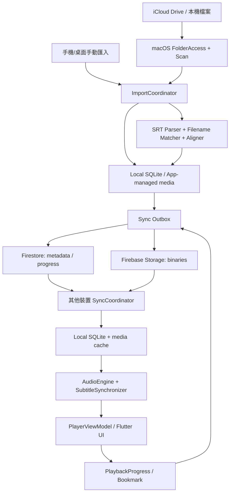

# 系統架構與資料流

## 1. 一眼看懂全貌



**資料方向**：使用者檔案 → 授權來源 → 匯入與識別 → 本機可靠保存 → 冪等雲端發佈 → 異機取用 → 播放與學習 → 進度回寫。不可用「一個 Repository 做全部」代替因果鏈。

## 2. 程式模組和依賴方向
```text
lib/
  app/                     # bootstrap / theme / router
  core/audio/              # AudioEngine contract + just_audio adapter
  core/db/                 # Drift/SQLite schema + migrations
  core/files/              # File gateway, hash, safe copy
  core/sync/               # auth context, queue, upload/download
  core/platform/           # Apple folder access MethodChannel gateway
  features/library/        # import list + playlist
  features/player/         # audio commands + subtitle display
  features/subtitles/      # parsing / matching / alignment
  features/learning/       # reveal mode + favorites
  features/settings/       # sync / account / local storage
```

`View → ViewModel → Repository → Service`。難以被 ViewModel 簡單表達且需重用的規則放 Domain（SubtitleAligner、RepeatPolicy、ProgressConflictResolver、ImportReconciler）。Domain 不 import Flutter UI、Firebase SDK 或 Swift 插件。Repository 不直接依賴其他 Repository，跨源協調用獨立 Coordinator / UseCase。

## 3. 技術決策與邊界
| 範圍 | 候選/選定 | 說明 |
|---|---|---|
| Flutter UI | Flutter Material 3 + go_router | 手機與桌面共用 widget；Responsive 分支 |
| 狀態管理 | Riverpod（專案選擇） | 模型層 API 暴露 immutable state，禁止 View 做資料持久化 |
| 音訊 | just_audio + audio_session | 封裝 AudioEngine；背景能力依平台 adapter 驗證 |
| 桌面/手機背景 | audio_service 或 just_audio_background（待 spike） | 必須先確認 macOS、iOS、Android 差異；不可猜測三平台功能一致 |
| 本機 | Drift + SQLite、app support directory | metadata authoritative local cache；本機檔案副本 |
| 雲端 | Firebase Auth / Firestore / Cloud Storage | Android、iOS、macOS plugin 可用性先 smoke test |
| iCloud folder | macOS Swift + Security-Scoped Bookmark | local-only 授權；檔案掃描與協調 |
| 字幕 | Dart SRT Parser / matcher | 不依賴播放器內建字幕 UI |

## 4. 不可跨越的契約
- `AudioEngine` 是唯一調用播放器 instance 的入口；消費者不取得 `AudioPlayer`。
- `SubtitleTrack` 的時間資料以整數毫秒（非 float 秒），對齊結果不可破壞原始字幕。
- 所有雲端寫操作經 `SyncOutbox`；媒體上傳完成後才把教材標為遠端可用。
- Security-Scoped Bookmark 只能在裝置本地安全保存，不同步到 Firebase。
- 同一教材內容雜湊與教材 UUID 是兩種身分：不同來源、同檔案可共享 binary，不能無條件合併播放紀錄。
- 雲端 Firestore snapshot 不應直接觸發正在播放的遠端 seek。

## 5. 初始化、生命週期與隔離
Flutter app 啟動先載入本機 DB → 渲染 Library → 再啟動雲端同步。Firebase 不可用時提供 local-only 狀態。使用者切換帳號必須清除/隔離個人 metadata、pending outbox，避免混入下一帳號。串流、subscription、file watcher 與 Player 必須由明確 owner dispose。

## 6. 驗收
Stage 1 建立 mock/fake 可注入契約及最小驗證 Spike；Stage 2 所有 domain 邏輯可離線測試；Stage 3 在真機測試同步和 Apple Sandbox；Stage 4 執行全鏈路回歸。參見 `08-testing-and-quality.md`。
